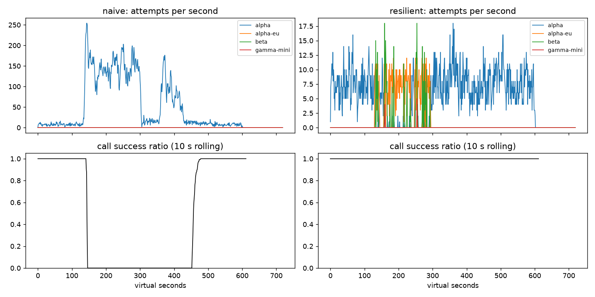

# Lab 25B — Report

**Họ tên / nhóm:** Le Tuan Dat — 202602623  **Commit:** 0ed5854
**Điểm tự động (`make grade`):** 84 / 88

> 4 điểm còn lại là "Part E — dữ liệu ẩn" (`hidden None` khi chạy local), chỉ giảng viên chấm được.
> Mọi số liệu dưới đây lấy từ `reports/gameday/*.json`, `reports/cache/*.json`, `reports/workflows.json`,
> `reports/slo.json` (seed 25). Client của tôi cũng PASS 6/6 băng + C1 với seed 1, 7, 42, 99.

## 1. Kết quả Game Day (naive vs của bạn)

| Băng | Client | availability | p95 (s) | amplification | retry_ratio | cost/turn | recovery (s) | PASS? |
|---|---|---:|---:|---:|---:|---:|---:|:---:|
| G1 | naive | 0.7194 | 7.157 | 7.738 | 6.738 | 2.163 | 4.0 | ❌ (avail, 36 027 vi phạm retry-after, ampl) |
| G1 | yours | 1.0000 | 4.780 | 1.063 | 0.001 | 2.104 | 0.0 | ✅ |
| G2 | naive | 0.4560 | 15.034 | 9.904 | 8.904 | 4.627 | 155.0 | ❌ (avail, ampl, recovery) |
| G2 | yours | 1.0000 | 10.362 | 1.037 | 0.005 | 2.112 | 0.0 | ✅ |
| G3 | naive | 1.0000 | 4.768 | 1.164 | 0.164 | 2.328 | 0.0 | ❌ (retry_ratio) |
| G3 | yours | 1.0000 | 4.621 | 1.058 | 0.030 | 2.140 | 0.0 | ✅ |
| G4 | naive | 1.0000 | 13.764 | 1.004 | 0.004 | 2.008 | 0.0 | ❌ (p95) |
| G4 | yours | 1.0000 | 5.626 | 1.014 | 0.002 | 2.072 | 0.0 | ✅ |
| G5 | naive | 0.3699 | 5.359 | 17.030 | 16.030 | 2.124 | — | ❌ (9 149 retry lỗi 400, avail) |
| G5 | yours | 0.8179 | 5.477 | 1.003 | 0.002 | 2.504 | — | ✅ (0 retry lỗi 400, 0 failover thừa) |
| G6 | naive | 0.5170 | 4.836 | 12.344 | 11.344 | 2.009 | 0.0 | ❌ (avail) |
| G6 | yours | 1.0000 | 5.961 | 1.055 | 0.018 | 2.196 | 0.0 | ✅ (0 incompatible route) |

Tổng: naive 0/6, của tôi 6/6. `primary_share_after_restore` của tôi: G1 0.904, G2 1.0, G4 1.0, G6 1.0.

## 2. Cấu hình client và lý do

| Tham số | Giá trị | Vì sao (dựa trên băng nào, số liệu nào) |
|---|---:|---|
| attempt_timeout_s | 8.0 | p99 lúc bình thường ≈ 5.4–6.5 s (G3 5.42, G5 6.46), nên 8 s không cắt nhầm call khỏe. Ở G6, `alpha-eu` **treo**: với 8 s chỉ mất 78 attempt timeout rồi breaker mở, availability 1.0. Thí nghiệm 2: timeout 30 s → G6 availability còn 0.9488 (FAIL). |
| max_attempts_per_provider | 2 | 1 retry cùng provider rồi failover. G3 (30% lỗi 500): xác suất 2 lần lỗi liên tiếp ≈ 9%, phần còn lại failover sang alpha-eu/beta → availability 1.0, retry_ratio 0.030 (ngưỡng 0.10). Thí nghiệm 1: 5 attempt + không budget → G3 retry_ratio 0.158 (FAIL). |
| backoff_base_s / cap_s | 0.25 / 4.0 | Full jitter: retry đầu chờ U(0; 0.25 s), không đốt deadline 30 s. Với 429 dùng `retry_after + U(0; 0.25)` → G1 và G2 có 0 vi phạm retry-after (naive: 36 027 và 28 381). |
| retry_budget_ratio | 0.1 | Retry ≤ ~10% lượng request đầu tiên (`min_per_s` 0.5, `max_tokens` 20). Đây là lớp phòng thủ cuối khi breaker cấu hình sai: thí nghiệm 1 → G2 amplification 1.378 (có budget) vs 1.580 (không budget). |
| breaker.window_size / min_calls | 20 / 10 | Cần ≥ 10 kết quả mới đánh giá, nên vài lỗi lẻ không mở breaker. Lỗi 400 không được tính: G5 có 413 lỗi 400 nhưng 0 failover thừa. G2: alpha quá tải → 117 timeout được tính vào breaker → breaker mở, tải chuyển sang alpha-eu (996 attempt) và beta (364); amplification chỉ 1.037. |
| breaker.failure_rate_threshold | 0.5 | Brown-out 30% ở G3 **không** mở breaker (30% < 50%): alpha vẫn nhận 3 012/4 082 attempt, retry + failover xử lý lỗi lẻ. Outage thật (G6 alpha 503 = 100%) mở ngay. |
| breaker.slow_call_s | 5.0 | G4 không có lỗi nào, alpha chỉ chậm thêm 5 s (≈ 6.2 s > 5). Breaker mở theo `slow_call_rate`, chuyển tải sang alpha-eu (2 012 attempt) → p95 5.626 s (naive 13.764 s). Bình thường alpha ≈ 1.2 s, nên ngưỡng 5 s cách xa hành vi khỏe. |
| breaker.open_duration_s | 10.0 | Đủ ngắn để quay lại primary nhanh: G2 recovery 0 s, primary_share sau khi khôi phục 1.0 (ngưỡng 0.8); G4/G6 cũng 1.0. |
| breaker.half_open_max_probes | 2 (cần 2 thành công) | Chỉ 2 request thăm dò provider đang hồi phục, không gây thundering herd. Một probe hỏng hoặc chậm → mở lại. |
| quota_cooldown_s | 300 | Hết quota là vấn đề billing, không phải transient. G5: chỉ 2 lỗi `insufficient_quota` rồi cả family A được bỏ qua và beta gánh (2 019 attempt). Naive: 35 715 lỗi quota. |

Sơ đồ quyết định của `on_error`:

```
classify(err)
 ├─ CLIENT_ERROR (400/401/422)  -> breaker.release  -> GiveUp("client_error")   (không retry, không failover)
 ├─ QUOTA_EXHAUSTED (429 quota) -> breaker.release  -> cooldown 300 s        -> failover ngay
 ├─ RATE_LIMITED (429 + RA)     -> breaker.release  -> cooldown = retry_after -> failover ngay
 │                                   (cả ladder đều bận -> chờ cooldown ngắn nhất ≤ 5 s nếu kịp deadline)
 └─ OVERLOADED / SERVER_ERROR / TIMEOUT
         -> breaker.on_failure
         -> tries < max_attempts_per_provider
            AND now + backoff + min_time_left ≤ deadline
            AND retry_budget.try_acquire()?
              ├─ có    -> retry CÙNG provider sau full-jitter backoff
              └─ không -> failover sang provider kế tiếp trong ladder (đã lọc theo tool calling)
Ladder hết -> GiveUp("no_provider_available")
```

## 3. Ba thí nghiệm

**1. Retry budget là lớp phòng thủ cuối.** (`breaker.min_calls: 1e9`, `max_attempts_per_provider: 5`)

| Cấu hình | G2 ampl | G2 retry_ratio | G2 recovery (s) | G2 p95 | G3 ampl | G3 retry_ratio |
|---|---:|---:|---:|---:|---:|---:|
| breaker đúng, budget bật (mặc định) | 1.037 | 0.005 | 0 | 10.36 | 1.058 | 0.030 |
| breaker đúng, budget **tắt**, 5 attempt | 1.035 | 0.004 | 0 | 9.92 | 1.034 | 0.020 |
| (a) breaker hỏng, budget bật | 1.378 | 0.058 | 0 | 19.25 | 1.136 | 0.068 |
| (b) breaker hỏng, budget **tắt** | 1.580 | 0.378 | 24 | 21.48 | 1.162 | **0.158 ❌** |

Khi breaker hỏng, budget là thứ duy nhất chặn retry: retry_ratio ở G2 giảm từ 0.378 xuống 0.058 (−85%), ở G3 từ 0.158 (FAIL) xuống 0.068 (PASS), và recovery ở G2 từ 24 s về 0. Khi breaker hoạt động đúng, tắt budget gần như không đổi gì (G2 ampl 1.035 vs 1.037), vì breaker đã fail fast trước khi retry kịp tích lũy. Hai cơ chế bảo vệ hai thứ khác nhau. Breaker bảo vệ *từng provider* và cần thời gian để nhận ra sự cố (`min_calls`); budget là giới hạn *toàn cục* cho tổng lượng retry, hoạt động cả khi breaker cấu hình sai, chưa kịp mở, hoặc khi lỗi rải đều ở dưới ngưỡng trip (như brown-out 30% ở G3). Vì vậy nên có cả hai, theo kiểu defense in depth.

**2. `attempt_timeout_s: 30`.**

| Băng | timeout 8 s | timeout 30 s |
|---|---|---|
| G4 | avail 1.0, p95 5.626 | avail 1.0, p95 5.608 (gần như không đổi) |
| G6 | avail **1.0**, p95 5.961 | avail **0.9488 ❌**, p95 5.440 |

G4 không đổi, vì alpha chỉ chậm khoảng 6.2 s (< 8 s) và chính slow-call breaker mới xử lý băng này. Ở G6, `alpha-eu` **treo** chứ không trả lỗi. Với timeout 30 s, mỗi attempt vào alpha-eu ngốn hết deadline 30 s của user trước khi kịp failover, và breaker cần 10 lần như vậy mới mở. Availability vì thế giảm 5.1 điểm, xuống dưới ngưỡng 0.95. (p95 thấp hơn chỉ vì p95 tính trên các lượt *thành công*; lượt bị treo đã thất bại nên không nằm trong p95.) Timeout đúng nên dựa vào phân phối latency khi khỏe, khoảng p99 cộng biên độ (ở đây p99 ≈ 5.5–6.5 s → 8 s). Đồng thời phải chừa thời gian trong deadline 30 s cho ít nhất 2–3 lần failover. Client của tôi cũng giới hạn mỗi attempt trong thời gian còn lại của deadline.

**3. Bỏ lọc tool calling khỏi `ladder()`** (chạy G6): availability 1.0 → **0.8922**, `incompatible_routes` 0 → **257** → FAIL.
Nói theo ngôn ngữ product manager: khi nhà cung cấp chính sập, hệ thống gửi 257 yêu cầu "hãy tra cứu đơn hàng và hoàn tiền" cho một model rẻ không biết dùng công cụ. Model đó không thể tra đơn hay tạo lệnh hoàn tiền, nên 257 lượt khách hàng nhận câu trả lời vô dụng hoặc thất bại, trong khi dashboard lại ghi là "đã chuyển dự phòng". Mất khoảng 11% số lượt trong một sự cố mà lẽ ra hệ thống phục vụ được 100%. Fallback chỉ có giá trị khi model dự phòng **làm được** việc đó.

## 4. Workflow hoàn tiền

| Executor | completion | crashes | duplicate refunds | duplicate emails | lost refunds | overpaid | wasted LLM / crash |
|---|---:|---:|---:|---:|---:|---:|---:|
| naive | 1.0 | 81 | 128 | 81 | 0 | 1 574 200 cent | 1.123 |
| yours | 1.0 | 66 | **0** | **0** | **0** | **0** | **0.303** |

- **Chỉ idempotency key là chưa đủ.** Key chặn được *tác dụng phụ trùng* (payment provider nhận lại cùng key thì trả lại kết quả cũ), nhưng worker mới sau crash vẫn phải chạy lại từ đầu: lại gọi LLM `classify`, lại `lookup_order`… Kết quả là tốn chi phí LLM (naive: 1.123 LLM call phí / crash, của tôi: 0.303), và mọi step không có idempotency (LLM, gửi email nếu không có key) đều chạy lại.
- **Chỉ checkpoint cũng chưa đủ.** Crash có thể xảy ra *sau khi* tiền đã chuyển nhưng *trước khi* kịp ghi checkpoint (`WorkerCrash` ngay sau payment), hoặc response bị mất (`ServiceTimeout`). Lần chạy lại không thấy checkpoint nên gọi payment lần nữa; nếu không có key ổn định theo (session, step) thì đó là hoàn tiền trùng. Naive bị 128 lần như vậy, trả thừa 1 574 200 cent.
- **Ghi checkpoint *trước* khi gọi payment:** nếu worker chết giữa lúc ghi checkpoint và lúc gọi payment, worker sau thấy checkpoint "issue_refund đã xong" nên bỏ qua. Tiền **không bao giờ** được hoàn: **lost refund**, lỗi tệ nhất vì khách mất tiền và không ai biết. Vì vậy thứ tự đúng là: chạy step (với idempotency key ổn định) → thành công → mới checkpoint.

## 5. Alerting & error budget

| Sự cố | Mong đợi | Naive alerter (5 phút > ngưỡng) | Burn-rate alerter | Độ trễ phát hiện (burn-rate) |
|---|---|---|---|---:|
| checkout_bug | page | page (1 phút) | page ✅ | 27 phút |
| provider_outage | page | page (0 phút) | page ✅ | 4 phút |
| deploy_blip | none | **false page** ❌ | none ✅ | — |
| slow_leak | ticket | **không phát hiện** ❌ | ticket ✅ | 1 337 phút (~22 giờ) |
| degraded_evening | page | page (214 phút) | page ✅ (luật 6×, 6h & 30m) | 291 phút |
| night_spike | none | **false page** ❌ | none ✅ | — |
| small_bump | none | **false page** ❌ | none ✅ | — |

Naive: 7 page, 3 false page, bỏ sót slow_leak → FAIL. Burn-rate: 3 page, 1 ticket, 0 false page → PASS.

Error budget 30 ngày (SLO 99.5%): 25 901 755 request, cho phép 129 508.8 lỗi, thực tế 55 618 lỗi
(availability 99.7853%) → **đã tiêu 42.95%, còn 57.05%** → **không đóng băng release**, vì `freeze_releases = False`
và vẫn còn hơn một nửa budget. Nên theo dõi tốc độ tiêu: slow_leak một mình đã kéo dài khoảng 22 giờ.

**Vì sao `small_bump` (20 phút ở 12% lỗi) không nên đánh thức ai?** Burn rate tức thời là 0.12 / 0.005 = 24×, nhưng chỉ
kéo dài 20 phút. Cửa sổ 1h chỉ thấy 0.12 × 20/60 = 4% lỗi → 8× < 14.4, nên luật page nhanh không bắn; cửa sổ 6h còn 1.3× < 6.
Tổng thiệt hại ≈ 20/43 200 × 24 ≈ **1.1% budget tháng** và sự cố đã tự hết. Đánh thức người ta lúc 11 giờ trưa
cho việc không cần hành động gấp sẽ gây alert fatigue, khiến on-call bỏ qua những page thật. Page chỉ dành cho việc
đe dọa SLO và cần người can thiệp *ngay*.

## 6. Postmortem — Băng G2 với client naive (blameless)



*Nguồn: `reports/gameday/naive_G2_overload_storm_timeseries.csv` (gộp theo cửa sổ 15 s), `reports/gameday/naive.json`.*

**Tóm tắt:** Lúc t=120 s, deployment `alpha` mất 75% GPU trong 3 phút. Client v1 có 3 tầng retry chồng nhau (tối đa
36 attempt/call, delay cố định 0,2 s, không breaker/fallback) đã khuếch đại tải lên khoảng 20 lần, vượt rate limit 20 rps và hàng đợi
của alpha. Kết quả: tỷ lệ thành công bằng 0 từ t≈145 đến t≈450, tức hệ thống vẫn sập thêm **155 s sau khi provider đã hồi phục
hoàn toàn**. Đây là một metastable failure do chính lớp retry của ta tự duy trì.

**Ảnh hưởng:** 1 285 / 2 362 lượt user thất bại (availability 45.6%), success ratio = 0 trong khoảng 5 phút (t≈145 → 450).
Chi phí mỗi lượt thành công tăng từ ~2.0 lên 4.627 (34 475 attempt cho 3 481 call). Với SLO 99.5% và lưu lượng 4 lượt/s,
error budget tháng là 0.5% × 10 368 000 ≈ 51 840 lượt lỗi. Riêng sự cố này đốt **≈ 2.5% budget tháng trong 10 phút**
(burn rate ≈ 54.4% / 0.5% ≈ 109×), đủ để luật fast-burn 14.4× page ngay.

**Timeline** (giây ảo, lấy từ CSV):

| t | Sự kiện | Bằng chứng (số) |
|---:|---|---|
| 0–120 | Bình thường | ~7.5 attempt/s, ~7.5 call xong/s, success 1.00, amplification ≈ 1 |
| 120 | alpha mất 75% năng lực (trigger) | 120–135: vẫn success 1.00 nhưng call xong/s giảm 7.6 → 3.1 (request bắt đầu xếp hàng) |
| 135–150 | Timeout 8 s bắt đầu, 3 tầng retry kích hoạt | attempt/s 7.6 → **173**, đỉnh **254 attempt/s ở t=143**; success 0.10 |
| 150–300 | Retry storm tự duy trì | 116–167 attempt/s (~20× bình thường, gấp ~8× rate limit 20 rps), success **0.00**. Lỗi tổng: 26 298 × 429, 3 194 × 529, 2 737 timeout; 28 381 lần vi phạm retry-after |
| 300 | alpha hồi phục hoàn toàn | năng lực trở lại 18 slot (~15 req/s) — lớn gấp đôi nhu cầu thật (~7.5 call/s) |
| 300–360 | **Hệ thống vẫn chưa hồi phục** | attempt/s giảm còn 15–31 nhưng success vẫn **0.00**: hàng đợi đầy request mà client đã timeout bỏ đi, server vẫn xử lý chúng |
| 360–420 | Đợt retry thứ hai | attempt/s tăng lại 77–130, success 0.00 |
| 450–465 | Hàng đợi bắt đầu thông | success 0.75 |
| 455 | Hồi phục (95% call thành công trong 30 s) | `recovery_s = 155` |
| 465–480 | Xả backlog | success 1.00, 13.5 call xong/s (gần gấp đôi bình thường) |

**Trigger vs root cause:**
- **Trigger:** alpha mất 75% GPU (sự kiện bên ngoài, sẽ còn xảy ra).
- **Root cause:** thiết kế retry của client: **3 tầng retry chồng nhau** (app 4 × gateway 3 × SDK 3 = 36 attempt/call),
  delay cố định 0,2 s **không jitter**, **không retry budget**, **không circuit breaker**, không tôn trọng `retry-after`,
  không fallback và không biết deadline. Một sự cố giảm năng lực bị biến thành tải gấp ~20 lần.
- **Vì sao không tự hồi phục sau t=300 (vòng lặp metastable):** (1) mỗi request timeout sau 8 s ở phía client nhưng *server
  vẫn tiếp tục xử lý nó*, nên hàng đợi đầy công việc vô ích; (2) request mới phải chờ sau đống đó → timeout hoặc nhận 529/429
  → lại bị retry tối đa 36 lần; (3) lượng retry (≥ 15–130 attempt/s) giữ tải **lớn hơn năng lực** 15 req/s và vượt
  rate limit 20 rps, nên hàng đợi không bao giờ rút. Vòng lặp *lỗi → retry → tải tăng → lỗi* tự duy trì dù trigger đã hết.
  Hệ thống chỉ thoát khi các call cũ hết lượt retry hoặc hết deadline 30 s và lưu lượng retry giảm xuống dưới năng lực (t≈450).

**Điều gì giúp / điều gì làm tệ hơn:**
- *Giúp:* deadline 30 s của user cuối cùng cũng cắt các call cũ (585 call bỏ cuộc vì deadline, 655 call hết 36 attempt); rate limit của provider chặn
  bớt tải nên alpha không sập hẳn; provider hồi phục đúng t=300.
- *Tệ hơn:* retry cả lỗi 429 mà không chờ `retry-after` (28 381 vi phạm); delay cố định làm mọi client quay lại cùng lúc;
  chỉ dùng mỗi alpha (`attempts_by_provider = {alpha: 34 475}`) trong khi alpha-eu và beta còn rảnh; timeout 8 s lặp lại
  mà không giới hạn tổng thời gian.

**Action items:**

| # | Hành động | Loại | Owner | Cách kiểm chứng |
|---|---|---|---|---|
| 1 | Chỉ retry ở **một** tầng (ResilientClient); đặt `max_retries=0` ở gateway và SDK | prevent | LLM Platform team | Test CI kiểm tra cấu hình gateway/SDK; G2 trong CI: amplification ≤ 1.2 (hiện 1.037) |
| 2 | Full-jitter backoff + tôn trọng `retry-after` + retry budget 10% | prevent | LLM Platform team | CI: `retry_after_violations = 0` trên G1/G2; G3 `retry_ratio ≤ 0.10` (hiện 0.030) |
| 3 | Circuit breaker sliding-window + fallback ladder alpha → alpha-eu → beta (lọc tool calling) | mitigate | LLM Platform team | CI: G2 `recovery_s ≤ 30` (hiện 0), `primary_share_after_restore ≥ 0.8` (hiện 1.0), availability ≥ 0.95 |
| 4 | Alert theo amplification (attempt / call > 1.5 trong 5 phút) và burn-rate đa cửa sổ | detect | SRE on-call rotation | Replay G2: alert bắn trong ≤ 2 phút sau t=135; replay dữ liệu SLI 30 ngày: 0 false page |
| 5 | Game Day định kỳ hằng quý với 6 băng sự cố + băng ẩn, nhiều seed | prevent | SRE + Platform | Lịch Game Day; `make grade` trong CI chặn merge khi băng nào FAIL |

*(Blameless: mọi hành động nhắm vào thiết kế hệ thống và quy trình review cấu hình retry, không nhắm vào cá nhân nào. Các tầng
retry được thêm riêng lẻ, mỗi tầng đều hợp lý khi đứng một mình. Vấn đề là không có cơ chế nhìn thấy tích của chúng.)*

## 7. Một điểm yếu còn lại

**p95 ở G2 = 10.36 s, p99 = 15.71 s**, cao nhất trong 6 băng dù availability 1.0. Trong vài giây đầu alpha quá tải, request
vẫn được gửi tới alpha và nằm trong hàng đợi dài cho đến khi hết timeout 8 s. Breaker cần `min_calls = 10` kết quả mới mở,
nên một nhóm user phải chờ ~8 s rồi mới được failover. Cách sửa:
(1) **hedged request**: nếu primary chưa trả lời sau ~p95 bình thường (≈ 3 s), gửi thêm một bản sang alpha-eu và lấy kết quả đến trước,
có giới hạn bằng retry budget để không thành retry storm; (2) theo dõi latency theo cửa sổ thời gian ngắn để breaker mở theo
slow-call sớm hơn; (3) timeout thích nghi theo p99 gần đây thay vì cố định 8 s.
Một điểm yếu khác là **chi phí**: ở G5 cost/turn là 2.504 (cao nhất) vì sau khi family A hết quota, beta (1.4/call) gánh mọi
thứ. Có thể chuyển các call `chat` không cần tool sang `gamma-mini` (0.2/call) khi primary không dùng được.

## 8. Cache (Part G)

Số từ `reports/cache/*.json` (`make cache`, băng C1_faq_outage):

| Client | availability | faq_availability | cache_hit_ratio | stale_served | wrong_answers | outdated_answers | cost/turn | PASS? |
|---|---:|---:|---:|---:|---:|---:|---:|:---:|
| resilient (không cache) | 0.8373 | 0.8424 | 0.000 | 0 | 0 | 0 | 1.386 | ❌ (faq_avail, hit) |
| cached (của tôi) | 0.9124 | **0.9645** | **0.652** | 157 | **0** | **3** | **0.915** | ✅ |

Cache giảm chi phí mỗi lượt thành công 34% (1.386 → 0.915) và giữ FAQ sống qua 2 phút mọi provider sập (157 câu trả lời stale).

| Tham số `cache:` | Giá trị | Vì sao (số liệu nào) |
|---|---:|---|
| similarity_threshold | 0.92 | 0.80 → **175** `wrong_answers` (`other_question`): các câu "gần mà khác" bị gộp. 0.92 → 0 câu sai, hit 0.652. 0.97 → vẫn 0 sai nhưng hit giảm còn 0.579 và cost tăng lên 0.965; ở ttl 30 s, hit còn 0.495 < 0.5 (FAIL). 0.92 nằm giữa vùng an toàn (0.90–0.95 đều cho 0 sai). |
| ttl_s | 60 | Giới hạn thời gian một câu trả lời cũ còn được phục vụ sau thay đổi **không báo trước** (bảng phí ship, t=480). ttl 300 → **95** `outdated_answers` (FAIL, ngưỡng 15); ttl 60 → 3; ttl 30 → 2 nhưng hit giảm 0.652 → 0.592. |
| max_stale_s | 600 | Phải dài hơn sự cố (provider sập 120 s, t=240–360) cộng TTL. `max_stale_s: 0` → faq_availability **0.8733** (FAIL, ngưỡng 0.93); 600 → 0.9645 với 157 câu trả lời stale. |
| max_entries | 500 | Băng C1 có 18 ý định FAQ không cá nhân, khoảng 55 cách diễn đạt, × 2 prompt version ≈ 110 entry tối đa, nhỏ hơn nhiều so với 500, nên LRU không phải đuổi entry còn dùng. |

Thí nghiệm:

1. **Ngưỡng** (ttl 60, stale 600):

   | threshold | hit | wrong_answers | cost/turn |
   |---:|---:|---:|---:|
   | 0.80 | 0.659 | **175** (`other_question`: 175) | 0.978 |
   | 0.92 | 0.652 | 0 | 0.915 |
   | 0.97 | 0.579 | 0 | 0.965 |

   Ở 0.80, mọi câu sai đều là `other_question`. Simulator cố ý tạo các cặp ý định "gần mà khác" với cosine giữa hai tâm
   ≈ 0.86: "Phí ship nội thành bao nhiêu?" và "Phí ship đi tỉnh bao nhiêu?", "Chính sách hoàn tiền thế nào?" và "Hoàn tiền mất mấy
   ngày?", "Đổi size áo thế nào?" và "Đổi màu sản phẩm được không?", "Hình thức thanh toán nào?" và "Có ship COD không?". Với ngưỡng
   0.80 (< 0.86), câu này nhận câu trả lời của câu kia. Các cách diễn đạt *cùng* một ý định nằm rất gần tâm (cosine 0.975–0.99),
   nên ngưỡng 0.92 vẫn bắt được paraphrase mà tách được các cặp gần-mà-khác. Cost/turn ở 0.80 (0.978) cao hơn ở 0.92 (0.915) dù hit
   cao hơn, vì faq_availability thấp hơn (0.8605) nên tổng chi phí chia cho ít lượt thành công hơn.
2. **TTL** (threshold 0.92, stale 600): ttl 30 → outdated 2, hit 0.592; ttl 60 → outdated 3, hit 0.652; ttl 300 → outdated **95**, hit 0.731.
   Webhook (`on_content_update`) chỉ giúp với thay đổi *được báo* (chính sách hoàn tiền ở t=150: 0 câu sai lý do
   `ignored_invalidation`). Bảng phí ship đổi ở t=480 **không có webhook**, nên cache không thể biết. Thứ duy nhất giới hạn thời gian
   một câu trả lời cũ còn được phục vụ là tuổi tối đa của entry, tức TTL: số câu lỗi thời ≈ lưu lượng câu hỏi đó × (thời gian
   entry còn tươi sau khi tài liệu đổi), tối đa ≈ lưu lượng × TTL.

   *Kiểm tra độ bền (16 seed):* số câu lỗi thời **không** giảm đều theo TTL mà phụ thuộc pha. Lúc deploy prompt v2 (t=420) mọi
   entry bị tạo lại, nên với TTL 60 chúng hết hạn đúng lúc bảng phí ship đổi (t=480): outdated trung bình 3.8, tối đa 8,
   0/16 seed fail. TTL 45 lệch pha: trung bình 10.8, tối đa 21, **4/16 seed fail**. Trên một bản băng tôi tự dịch thời điểm
   (deploy t=470, đổi phí t=520, outage dài 150 s) thì TTL 30 và TTL 60 đều fail 1/16 seed (tối đa 17). Vì băng chấm thật
   bị lệch thời điểm, tôi chọn TTL theo **trường hợp xấu nhất** (≈ lưu lượng × TTL) thay vì theo một pha may mắn. TTL 60 vẫn
   là lựa chọn cân bằng: rủi ro ngang TTL 30 nhưng hit ratio tối thiểu cao hơn (0.612 so với 0.554).
3. **Stale-if-error** (`max_stale_s: 0`): faq_availability 0.9645 → **0.8733**, stale_served 157 → 0. Không có stale-if-error thì
   trong 2 phút mọi provider sập, câu FAQ chỉ được cứu nếu entry còn tươi (< 60 s), nên phần lớn thất bại.

Trả lời:

- **Vì sao câu hỏi cá nhân ("Đơn #48213 của tôi đang ở đâu?") không được cache, kể cả khi cache theo từng user?**
  (1) Câu trả lời phụ thuộc trạng thái sống của dữ liệu (đơn vừa chuyển sang "đang giao", tiền hoàn vừa về) chứ không phụ thuộc
  tài liệu nào, nên không có webhook để invalidate và TTL nào cũng có thể sai. (2) Semantic matching dễ ghép nhầm
  "đơn #48213" với "đơn #48231" vì embedding gần như trùng nhau: trả nhầm thông tin đơn khác cho chính user đó. (3) Chỉ cần một lỗi scope
  (quên `user_id` trong key, cache chung tầng CDN/gateway) là lộ dữ liệu cá nhân của người khác (`other_user`). Trong simulator,
  câu hỏi của hai user khác nhau chỉ khác số đơn nên cosine ≈ 0.99, cao hơn mọi ngưỡng hợp lý. Đây là rủi ro bảo mật
  và pháp lý lớn hơn nhiều so với lợi ích. (4) Mỗi user hỏi về đơn của mình rất ít lần, nên hit ratio gần 0: rủi ro cao, lợi ích thấp.
- **Mọi provider sập nhưng dashboard vẫn xanh nhờ cache. Alert dựa trên số nào?** Đo SLI **ở phía provider/origin**, không chỉ
  ở phía user: (1) tỷ lệ `stale_served` / tổng lượt FAQ (bình thường = 0, bất kỳ giá trị > vài % trong 5 phút → page);
  (2) success ratio của các attempt tới provider và số breaker đang OPEN (cả 4 OPEN → page); (3) `give_up_reasons =
  no_provider_available` của lượt không phải FAQ, vì những lượt đó vẫn thất bại (availability tổng 0.9124 < faq 0.9645).
  Thêm nữa, burn-rate alert nên tính câu trả lời stale là "degraded", để on-call biết đang sống nhờ cache và còn bao lâu
  (`max_stale_s`) trước khi cache cũng hết hạn.
